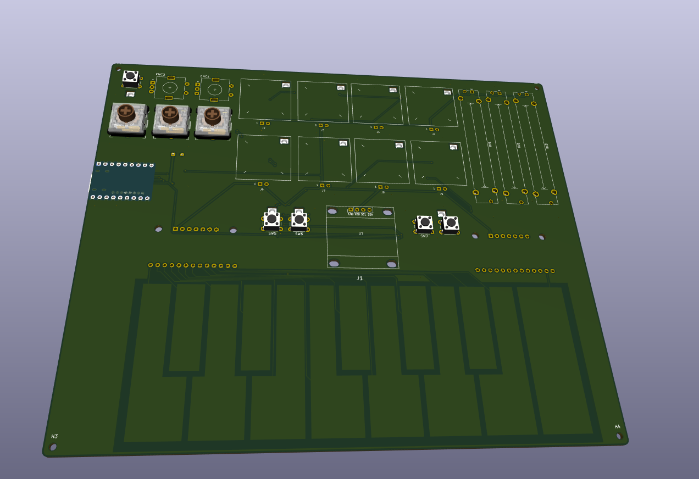
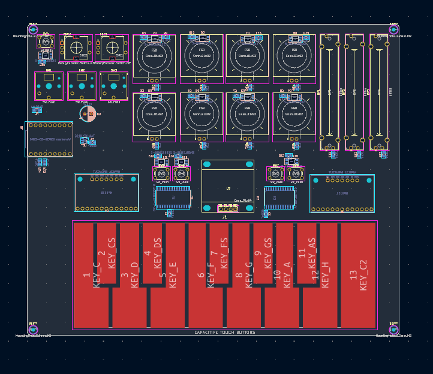
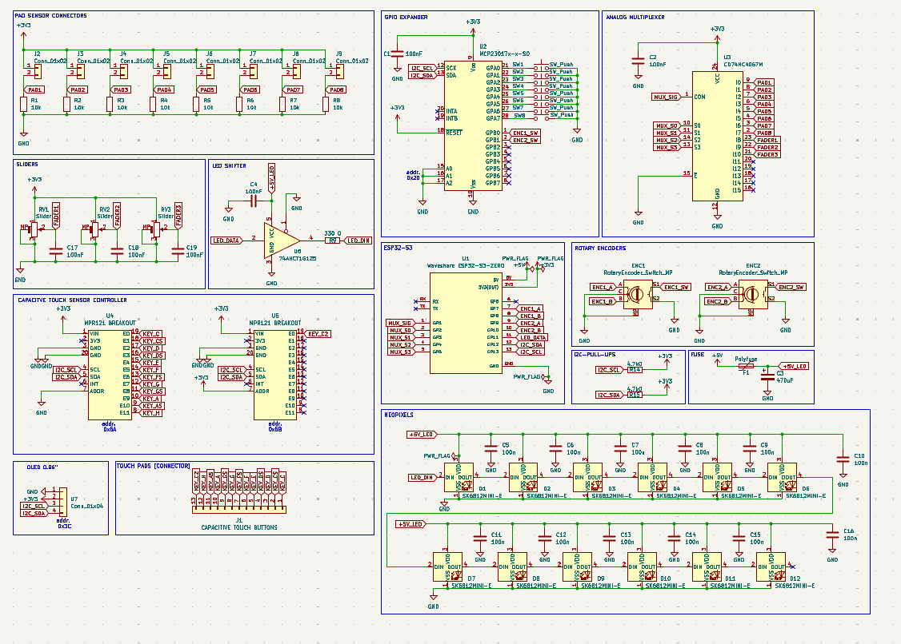

# Pocketone
A compact midi board that fits into any pocket and still has a lot of features 

Inspiration came from this Repo with brilliant tutorial: [have a look]([https://github.com/SharKingStudios/Starbie/tree/main](https://github.com/KaiPereira/MIDI-Keypad/blob/master/README.md))

# What is this

Pocketone is a project, made for the [Half life](https://halflife.hackclub.com) by Hackclub programm. It is an MIDI keyboard with compact design and lots of features. It can be used to create music inputs for a computer or laptop.

The Board features a Microcontroller, display, buttons, and capacitive sensors in a compact PCB design. It is USB powered and easy to build.

# Project status

The project is half finished but more features and maybe tutorial will come soon.

# Motivation

The main motivation is of course the Half Life (LINK) program by hackclub. It was designed in week three of the project where the task was to create a music PCB. Other than that, I really wanted to design a PCB for a long time now and it definitely won’t be my last one. It was quite som challenge to cook that midi board up and its not nearly finished but im proud of my result.

# Project journaling

Via the [Half life](https://halflife.hackclub.com) by Hackclub programm, several Journal entries have been made either in timelaps form or as written entry to track the project. 

# Assembly

The assembly should be quite beginnerfriendly. The board itself has not many part and is partly prefabricated. All remaining components are easy to be soldered by hand.

# Schematic and components

The board is powered by the Waveshare ESP32-S3-ZERO. It provides the power and data connector with an onboard USB-receptacle. The board also features a keyboard in form of capacitive sensors and a small OLED display. Furthermore it has 3 fader sliders and 8 preassure sensor pads. Everything is made possible by an GPIO expander and a MUX.

# PCB

The PCB is a simple 2 layer PCB. NOthing special about it 

# Firmware

Sadly there is no firmware yet.

# BOM
